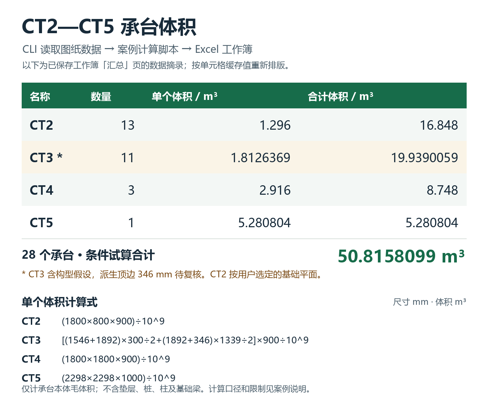
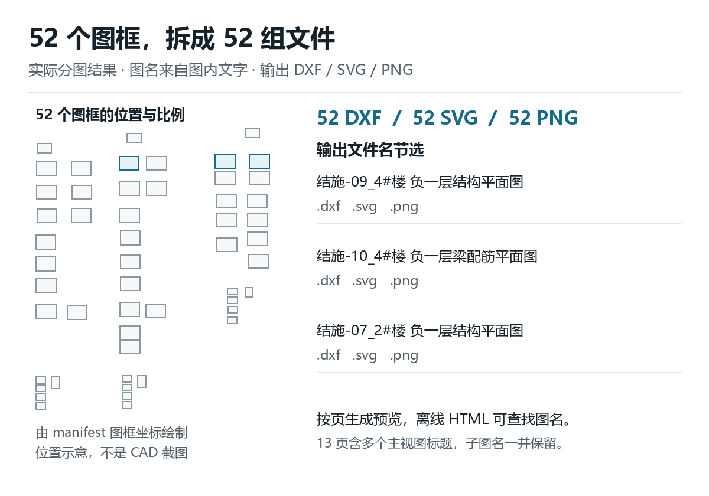
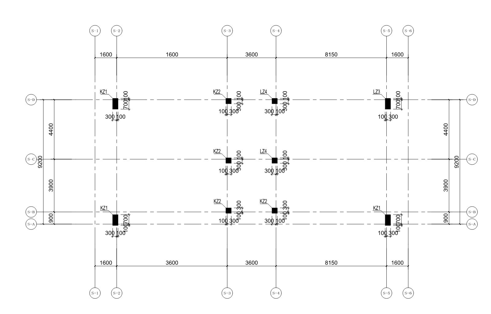
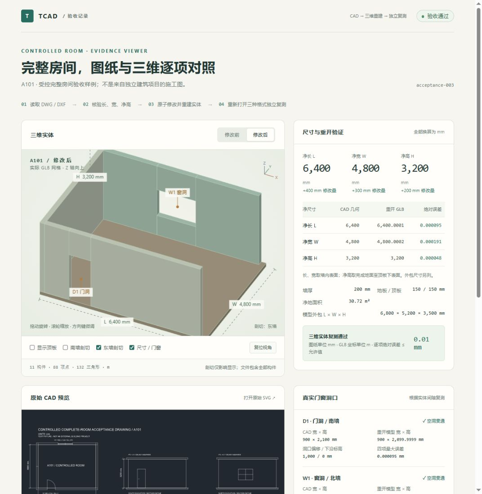

# TCAD Agent CLI

让 agent 用命令行处理 DWG / DXF：查实体、量尺寸、改图、按图框拆分，再生成可直接查看的 SVG。无需启动 CAD 界面；命令返回 JSON，预览、模型和批量数据可写入文件。

作者 **LiTao** · [Apache-2.0](LICENSE) · [当前版本 v0.3.1](https://github.com/18273778775/tcad-agent/releases/tag/v0.3.1)

## 安装

已有 [uv](https://docs.astral.sh/uv/getting-started/installation/) 和 Git，运行一行命令：

```sh
uv tool install --python 3.12 git+https://github.com/18273778775/tcad-agent.git@v0.3.1
```

Windows 也可用 PowerShell 安装，需要已有 CPython 3.11–3.14：

```powershell
irm https://raw.githubusercontent.com/18273778775/tcad-agent/v0.3.1/scripts/install.ps1 | iex
```

安装后先运行 `tcad capabilities`、`tcad schema request`。uv 用户若找不到命令，执行 `uv tool update-shell` 后重开终端。升级、卸载、离线 wheel 和其他安装方式见[安装文档](docs/installation.md)。目前从 GitHub 安装，尚未发布到 PyPI。

读取 DWG 还需要转换器。Windows x64 可运行 `tcad setup-dwg`，随后用 `tcad doctor` 检查。该命令安装固定的官方 LibreDWG 0.14；下列工程案例使用另行配置的 0.14.8612，默认后端未能读通其中的承台图。DXF 无需转换器。

## 实际案例

### 从基础平面图取数，列出 CT2–CT5 承台体积

CLI 用于查找承台名称、实例和尺寸证据，再由案例计算脚本生成 Excel。四类承台数量分别为 **13、11、3、1**；图中列出单个计算式和合计，便于逐项核对。



按本次选定口径，合计为 **50.8158099 m³**。CT2 平面与详图长度矛盾，本次按用户指定的平面尺寸 1800 × 800 × 900 mm 计算；CT3 含待复核的截角构型假设。因此这个合计是条件计算结果，不能直接作为审定工程量。Excel 由案例脚本生成，CLI 当前没有通用的 Excel 算量命令。[查看计算口径与核验范围](docs/cases/takeoff.md)。

### 一张结构总图，拆成 52 张有名字的图纸

这份实图包含 **52 个图框、30,433 个原生实体**。一次 `split` 生成 52 份独立 DXF、52 张 SVG、52 张 PNG，以及可搜索的离线 HTML 图集；文件名取自框内图名。多标题页面保留主标题和子标题。



拆完后，可以只打开其中一张 DXF，按图层保留轴网、轴号、柱和柱标注。下图来自该单页的柱图局部，保留了 **10 个柱轮廓、10 个柱标注和 20 个轴号**。



52 张导出文件均做了回读检查；另有 25 个未归属实体保存在余料文件中。源图的 104 处外链图片缺失，20 张图有字体警告，生成预览不代表这些内容已恢复。[查看分图结果与显示边界](docs/cases/sheet-split.md)。

### 房间图纸与三维模型核对长、宽、高

受控房间样例把平面和立面中的尺寸显式映射到模型。净尺寸由 6000 × 4500 × 3000 mm 改为 **6400 × 4800 × 3200 mm** 后，重新读取源图和模型进行比较，最大净尺寸误差为 **0.000191 mm**，验收容差为 0.01 mm。



这项验证适用于显式映射的轴对齐矩形房间。公开样图、六个模型和交互查看页见 [房间演示](docs/demo/README.md)，操作方法见[房间工作流](docs/room-workflow.md)。工程案例仅公开脱敏预览，原始施工图不随仓库分发。

## 开始处理一张图

```sh
tcad info drawing.dxf
tcad query drawing.dxf --type CIRCLE --layer HOLES --fields handle,type,layer --limit 20
tcad render drawing.dxf --output preview.svg
tcad split drawing.dwg --output-dir sheets
```

图层名需要换成当前图纸中的名称。`split` 的目标目录必须是新目录，父目录须已存在；默认同时生成预览和 HTML 图集。

先拆图，再对单张图做分层预览：

```sh
tcad info "sheets/柱配筋图.dxf"
tcad render "sheets/柱配筋图.dxf" --layers AXIS AXIS_LABEL COLUMN COLUMN_LABEL --foreground monochrome --output columns.svg
```

这里的文件名和图层名是用法示例。保留分图目录中的 `manifest.json`，CLI 会核验该单页的 SHA-256 并沿用原图框。需要进一步框选时可加 `--bbox`。完整参数见[分图与预览工作流](docs/sheet-workflow.md)。

## 已有功能

| 需要做什么 | 命令 | 当前能提供的结果 |
| --- | --- | --- |
| 了解工具与请求格式 | `capabilities` / `schema` / `doctor` | 能力、限制、JSON Schema、转换器状态 |
| 读取图纸 | `info` / `convert` | 单位、布局、图层、实体数量；DWG 转 DXF |
| 找实体和文字 | `index` / `query` / `export` | 图层、类型、文字、范围查询，分页与 JSONL 文件导出 |
| 测量与面积计算 | `measure` / `area` | 支持实体的长度、面积；轮廓面积并集与重叠量 |
| 拆图与命名 | `sheets` / `split` | 图框、标题证据、独立 DXF、预览和 HTML 图集 |
| 查看整图或局部 | `render` | SVG / PNG，按图幅、范围和有效图层筛选 |
| 关联标注与轴网 | `associate` / `axes` | 包含、距离、引线关联；正交轴网和交点 |
| 修改图纸 | `apply` | 声明式 JSON 编辑，先验证再原子发布 DXF |
| 核对房间模型 | `room-extract` / `room-model` / `room-verify` | 显式映射提取，GLB / OBJ / 三维 DXF，文件回读核验 |
| 连续调用 | `serve` / `batch` | JSONL 请求响应，按顺序执行的批量请求 |

## 给 agent 的调用约定

正常操作的 stdout 只含 JSON。判断 `ok` 和 `error.code`；默认响应上限为 **32 KiB**，先选 `--fields`、`--no-provenance` 和合理的 `--limit`，避免把整张图灌进上下文。

分页沿用 `next_cursor`，同时保持筛选和字段不变。看到 `output.truncated`、`truncation` 或 `geometry_page` 时，不能把当前片段当成完整数据。大量数据用 `export --output selected.jsonl` 写入文件；`--result-file` 只保存本次结果或当前页。

测量前确认单位；近似包围框不能当尺寸证据。DWG 转换或导出后重新查询 handle。编辑先用 `--dry-run`，默认保留原图并拒绝覆盖；DWG 编辑输出为 DXF。单个编辑计划是事务，整个 `batch` 不是事务。

详细协议、输出预算和资源上限见 [Agent 调用指南](docs/agent-usage.md)。

## 当前还做得不够好的地方

- **DWG 兼容性依赖外部后端。** 复杂对象可能在转换时丢失，默认转换器也未能覆盖所有已测实图；当前不能写回 DWG。
- **大图查询优化尚未覆盖整个流程。** 已有 100k 实体分页基准，但测量、完整导出和渲染仍需按命令解码图纸。32 KiB 输出上限约束返回体积，不保证只计算少量数据。
- **图框与图名识别仍靠规则。** 斜放、缺边图框和纸空间视口还原不在自动识别保证内，多标题仍需复核。
- **SVG 与 CAD 原貌仍有差距。** SHX、bigfont、专用符号和缺失外链图片会影响显示；密集填充可能简化。
- **几何计算还不是构件算量。** `measure` 尚不能直接测量整个 INSERT 块；部分曲线面积需要离散化，未提供可认证的面积误差上界。标注关联和正交轴网也不能替代结构语义识别。
- **房间与 Excel 案例有明确范围。** 房间依赖人工映射；Excel 依赖案例脚本，尚无通用工程量规则和表格生成命令。

按当前代码逐项核对的 [10 项不足与依据](docs/current-limitations.md)。

## 文档与开发

[安装](docs/installation.md) · [Agent 调用](docs/agent-usage.md) · [分图与 SVG](docs/sheet-workflow.md) · [房间建模](docs/room-workflow.md) · [性能实测](docs/large-drawing-performance.md) · [验证说明](docs/validation.md) · [更新记录](CHANGELOG.md)

开发环境运行 `scripts/bootstrap.ps1`，测试使用 `.venv\Scripts\python.exe -m pytest -q`。v0.3.1 本地验证为 376 项通过、1 项可选测试跳过、9 subtests 通过；对应的 Windows / Linux、Python 3.11–3.13 及真实 DWG 转换 [CI 全部通过](https://github.com/18273778775/tcad-agent/actions/runs/39888233435)。查询基准的适用范围和端到端耗时单独记录在性能文档中。

项目独立实现，不依赖原看图软件的 EXE / DLL。分析依据见[静态逆向报告](docs/reverse-engineering.md)和[开源项目选型](docs/upstream-projects.md)。

Copyright 2026 **LiTao**。原创代码、文档和受控房间示例采用 [Apache License 2.0](LICENSE)，允许商业使用。分发时保留适用的许可证与 [NOTICE](NOTICE)；第三方依赖的条款见 [THIRD_PARTY_NOTICES.md](THIRD_PARTY_NOTICES.md)。
